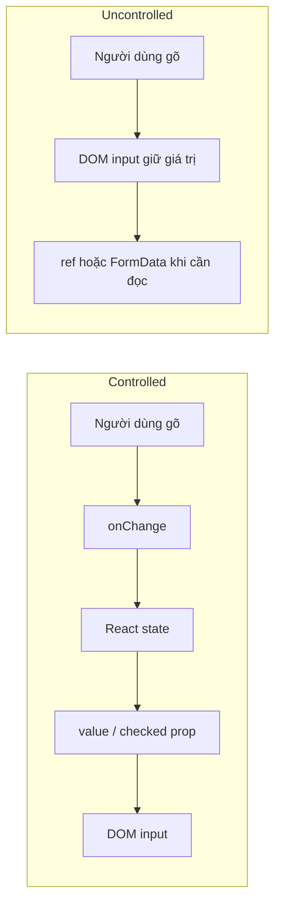

<Callout type="info" title="Mục tiêu phỏng vấn">

Nhà tuyển dụng không chỉ muốn nghe định nghĩa. Họ muốn biết bạn có xác định được **ai là nguồn dữ liệu đáng tin cậy** (source of truth), chọn đúng API `value`/`defaultValue`, và tránh đổi chế độ điều khiển giữa vòng đời component hay không.

</Callout>

## Mục lục

- [Câu trả lời trong 30 giây](#câu-trả-lời-trong-30-giây)
- [Mô hình tư duy: ai sở hữu state?](#mô-hình-tư-duy-ai-sở-hữu-state)
- [Controlled component](#controlled-component)
  - [Ví dụ input có validation tức thời](#ví-dụ-input-có-validation-tức-thời)
  - [Đặc điểm, lợi ích và chi phí](#đặc-điểm-lợi-ích-và-chi-phí)
- [Uncontrolled component](#uncontrolled-component)
  - [Đọc dữ liệu bằng ref](#đọc-dữ-liệu-bằng-ref)
  - [Đọc dữ liệu bằng FormData](#đọc-dữ-liệu-bằng-formdata)
  - [Đặc điểm, lợi ích và giới hạn](#đặc-điểm-lợi-ích-và-giới-hạn)
- [So sánh nhanh](#so-sánh-nhanh)
- [Chọn cách nào trong thực tế](#chọn-cách-nào-trong-thực-tế)
- [API tương ứng cho các form element](#api-tương-ứng-cho-các-form-element)
- [Các bẫy thường bị hỏi](#các-bẫy-thường-bị-hỏi)
  - [Đừng đổi chế độ trong vòng đời component](#đừng-đổi-chế-độ-trong-vòng-đời-component)
  - [`value` không có `onChange`](#value-không-có-onchange)
  - [`defaultValue` không cập nhật input đang mount](#defaultvalue-không-cập-nhật-input-đang-mount)
  - [File input luôn uncontrolled](#file-input-luôn-uncontrolled)
- [Controlled ở cấp component, không chỉ input](#controlled-ở-cấp-component-không-chỉ-input)
- [Câu trả lời mẫu hoàn chỉnh](#câu-trả-lời-mẫu-hoàn-chỉnh)
- [Câu hỏi đào sâu thường gặp](#câu-hỏi-đào-sâu-thường-gặp)
- [Tài liệu tham khảo](#tài-liệu-tham-khảo)

---

## Câu trả lời trong 30 giây

**Controlled component** là component có giá trị hiện tại do React state ở bên ngoài nó quyết định. Với input, React truyền `value` hoặc `checked`, rồi cập nhật state qua `onChange`. React state là nguồn dữ liệu đáng tin cậy duy nhất.

**Uncontrolled component** để DOM tự giữ giá trị hiện tại. React chỉ đặt giá trị ban đầu qua `defaultValue` hoặc `defaultChecked`, sau đó đọc giá trị khi cần bằng `ref` hoặc `FormData`.

Chọn controlled khi UI khác phải phản ứng ngay với dữ liệu: validation trực tiếp, nút submit phụ thuộc form, format input, hoặc đồng bộ nhiều field. Chọn uncontrolled cho form đơn giản, file input, tích hợp DOM/thư viện ngoài, hoặc khi chỉ cần dữ liệu lúc submit. Không đổi một input từ controlled sang uncontrolled, hoặc ngược lại, trong lúc nó đang mount.

<Callout type="idea" title="Câu chốt nên nói">

Sự khác biệt không nằm ở việc có dùng state hay không. Nó nằm ở **nơi giữ giá trị hiện tại**: React giữ thì controlled; DOM giữ thì uncontrolled.

</Callout>

## Mô hình tư duy: ai sở hữu state?

Một ô input luôn có giá trị hiện tại. Câu hỏi là giá trị đó được quyết định ở đâu.



Với controlled input, DOM vẫn phản ánh ký tự người dùng vừa gõ trước tiên. Nhưng sau event, React state được cập nhật và lần render tiếp theo truyền giá trị về input. Vì thế state mới là nơi quyết định UI cuối cùng.

Với uncontrolled input, React không theo dõi từng lần gõ. DOM duy trì giá trị nội bộ như khi bạn dùng HTML thuần. React chỉ truy vấn DOM ở thời điểm cần thiết.

## Controlled component

Một text input được điều khiển khi nhận cả `value` là string và `onChange` để cập nhật giá trị đó.

```tsx
import { useState } from 'react';

function ControlledNameField() {
  const [name, setName] = useState('An');

  return (
    <label>
      Tên
      <input
        value={name}
        onChange={(event) => setName(event.target.value)}
      />
    </label>
  );
}
```

Mỗi lần gõ, flow là: browser phát event → `onChange` gọi setter → React render lại → prop `value` cập nhật DOM. Không có đường nào để DOM tự giữ một giá trị khác state lâu dài.

### Ví dụ input có validation tức thời

Controlled phù hợp khi giao diện phải thay đổi ngay theo nội dung người dùng nhập.

```tsx
import { useState } from 'react';

function EmailField() {
  const [email, setEmail] = useState('');
  const isValid = /^\S+@\S+\.\S+$/.test(email);

  return (
    <>
      <label>
        Email
        <input
          type="email"
          value={email}
          onChange={(event) => setEmail(event.target.value)}
          aria-invalid={email !== '' && !isValid}
        />
      </label>
      {email !== '' && !isValid && <p>Nhập địa chỉ email hợp lệ.</p>}
      <button disabled={!isValid}>Tiếp tục</button>
    </>
  );
}
```

Ở đây `isValid`, thông báo lỗi và trạng thái nút đều được suy ra từ cùng `email` state. Nếu để input uncontrolled, bạn phải tự đọc DOM hoặc thêm state khác để các phần UI này biết giá trị mới; khi đó lợi ích đơn giản của uncontrolled gần như mất đi.

### Đặc điểm, lợi ích và chi phí

| Khía cạnh | Controlled |
|---|---|
| Nơi giữ giá trị hiện tại | React state |
| API chính | `value` + `onChange`, hoặc `checked` + `onChange` |
| Đồng bộ UI khác | Tự nhiên vì mọi thứ cùng đọc state |
| Reset / điền sẵn dữ liệu mới | Đổi state |
| Validation | Dễ làm khi gõ, khi blur hoặc khi submit |
| Chi phí | Thường có render cho mỗi thay đổi; cần tối ưu nếu form rất lớn hoặc logic mỗi render đắt |

Render mỗi lần gõ **không tự động là vấn đề hiệu năng**. Phần lớn form nhỏ hoàn toàn ổn. Chỉ đo và tối ưu khi Profiler cho thấy việc gõ bị chậm, chẳng hạn do một subtree lớn cùng render hoặc vì validation nặng chạy trên mỗi ký tự.

<Callout type="info" title="Quy tắc kiểu dữ liệu">

`value` của text input phải luôn là string. Khởi tạo bằng `''` thay vì `undefined` hoặc `null`. Với checkbox, dùng boolean `checked`, không dùng `value` để biểu diễn trạng thái tick.

</Callout>

## Uncontrolled component

Uncontrolled input nhận giá trị khởi tạo qua `defaultValue` hoặc `defaultChecked`. Sau mount, DOM tự sở hữu giá trị hiện tại.

```tsx
function UncontrolledNameField() {
  return (
    <label>
      Tên
      <input name="name" defaultValue="An" />
    </label>
  );
}
```

`defaultValue="An"` là giá trị ban đầu, không phải lệnh bắt DOM luôn bằng `An`. Người dùng có thể sửa ô input mà component không cần `useState` và không render lại vì mỗi lần gõ.

### Đọc dữ liệu bằng ref

Dùng ref khi bạn cần thao tác với đúng một DOM element, ví dụ focus hoặc đọc giá trị khi submit.

```tsx
import { useRef } from 'react';

function SearchForm() {
  const inputRef = useRef<HTMLInputElement>(null);

  function handleSubmit(event: React.FormEvent<HTMLFormElement>) {
    event.preventDefault();
    const query = inputRef.current?.value.trim() ?? '';
    console.log('Search:', query);
  }

  return (
    <form onSubmit={handleSubmit}>
      <input ref={inputRef} name="query" defaultValue="React" />
      <button>Tìm kiếm</button>
    </form>
  );
}
```

Không đưa `inputRef.current.value` vào JSX để hiển thị dữ liệu động. Thay đổi ref không schedule render, nên UI khác sẽ không biết giá trị này đã đổi. Nếu UI khác cần phản ứng, hãy dùng controlled state hoặc cập nhật state rõ ràng ở thời điểm phù hợp.

### Đọc dữ liệu bằng FormData

Với form nhiều field, `FormData` thường gọn hơn việc tạo nhiều ref. Nó đọc các control có thuộc tính `name` khi form submit.

```tsx
function SignUpForm() {
  function handleSubmit(event: React.FormEvent<HTMLFormElement>) {
    event.preventDefault();

    const formData = new FormData(event.currentTarget);
    const data = {
      name: String(formData.get('name') ?? ''),
      newsletter: formData.get('newsletter') === 'on',
    };

    console.log(data);
    event.currentTarget.reset();
  }

  return (
    <form onSubmit={handleSubmit}>
      <label>
        Tên <input name="name" defaultValue="An" />
      </label>
      <label>
        <input name="newsletter" type="checkbox" defaultChecked />
        Nhận bản tin
      </label>
      <button type="submit">Đăng ký</button>
    </form>
  );
}
```

`form.reset()` đưa uncontrolled field trở về giá trị mặc định ban đầu. Với controlled field, `reset()` không đủ vì render kế tiếp sẽ lại áp giá trị từ React state; hãy reset state thay vào đó.

### Đặc điểm, lợi ích và giới hạn

| Khía cạnh | Uncontrolled |
|---|---|
| Nơi giữ giá trị hiện tại | DOM node |
| API chính | `defaultValue` / `defaultChecked`, `ref`, `FormData` |
| Đồng bộ UI khác khi gõ | Không có sẵn; phải đọc DOM hoặc đưa dữ liệu vào state |
| Reset | `form.reset()` hoặc thao tác DOM; thay `key` để remount khi cần |
| Validation | Tận dụng HTML constraint validation hoặc kiểm tra khi submit |
| Điểm mạnh | Ít code hơn cho form chỉ đọc dữ liệu lúc submit; hợp với DOM API và thư viện ngoài |

## So sánh nhanh

| Câu hỏi | Controlled | Uncontrolled |
|---|---|---|
| Giá trị hiện tại ở đâu? | React state | DOM |
| Props khởi tạo / điều khiển | `value` hoặc `checked` | `defaultValue` hoặc `defaultChecked` |
| Có render khi người dùng gõ? | Thường có | Không vì riêng thao tác gõ |
| Lấy dữ liệu lúc submit | Đọc state | `FormData` hoặc ref |
| Format khi gõ (`12,000`, uppercase) | Dễ vì state điều khiển output | Khó hơn, phải can thiệp DOM |
| Nhiều UI cùng phụ thuộc field | Phù hợp | Sớm muộn thường phải thêm state |
| Tích hợp widget DOM bên thứ ba | Cần ranh giới đồng bộ rõ ràng | Thường đơn giản hơn |
| File input | Không áp dụng | Bắt buộc |

## Chọn cách nào trong thực tế

Không có lựa chọn luôn tốt hơn. Hãy chọn theo nơi cần tiêu thụ dữ liệu và thời điểm cần phản ứng.

<Steps>
  <Step>

### Xác định thời điểm cần giá trị

Nếu chỉ cần giá trị khi người dùng submit, bắt đầu với HTML form + `FormData` thường là đủ. Đó là uncontrolled.

Nếu cần dùng giá trị trong lúc gõ — ví dụ preview, bộ đếm ký tự, query tìm kiếm, disable nút hoặc validation tức thời — cần state React. Đó là controlled.

  </Step>
  <Step>

### Xác định ai khác phụ thuộc dữ liệu

Nếu chỉ chính input dùng giá trị, uncontrolled giúp code ngắn. Nếu sibling, parent, URL, Context hoặc server action state phải đồng bộ với nó, nâng state lên React để có một nguồn dữ liệu chung.

  </Step>
  <Step>

### Kiểm tra ranh giới tích hợp

Với rich-text editor, map, date picker cũ hoặc plugin thao tác trực tiếp DOM, để widget tự quản lý nội bộ rồi giao tiếp qua callback/ref có thể ít ma sát hơn. Đừng vừa để widget tự sửa DOM vừa buộc `value` từ React vào nó nếu API của widget không hỗ trợ mô hình đó.

  </Step>
</Steps>

<Callout type="idea" title="Quy tắc thực dụng">

Bắt đầu bằng cách đơn giản nhất đáp ứng yêu cầu. Chỉ chuyển sang controlled khi dữ liệu cần điều khiển hoặc chia sẻ; chỉ giữ uncontrolled khi DOM thực sự là nơi phù hợp để sở hữu state.

</Callout>

## API tương ứng cho các form element

| Element | Controlled | Uncontrolled | Ghi chú |
|---|---|---|---|
| `<input type="text">` | `value` + `onChange` | `defaultValue` | `value` luôn là string |
| `<textarea>` | `value` + `onChange` | `defaultValue` | Không dùng children làm giá trị trong React |
| `<select>` | `value` + `onChange` | `defaultValue` | Đặt giá trị ở `<select>`, không đặt `selected` cho `<option>` |
| Checkbox / radio | `checked` + `onChange` | `defaultChecked` | `checked` là boolean |
| `<input type="file">` | Không hỗ trợ | ref / `FormData` | Browser chỉ cho người dùng chọn file |

Ví dụ select controlled:

```tsx
function FlavorPicker() {
  const [flavor, setFlavor] = useState('vanilla');

  return (
    <select value={flavor} onChange={(event) => setFlavor(event.target.value)}>
      <option value="vanilla">Vanilla</option>
      <option value="chocolate">Chocolate</option>
    </select>
  );
}
```

## Các bẫy thường bị hỏi

### Đừng đổi chế độ trong vòng đời component

React quyết định một input là controlled khi render nó với `value` hoặc `checked` khác `undefined`. Quyết định này phải ổn định từ lúc mount đến unmount.

```tsx
// ❌ Lần đầu uncontrolled vì name là undefined; sau fetch lại thành controlled.
<input value={user?.name} onChange={handleChange} />

// ✅ Luôn controlled.
<input value={user?.name ?? ''} onChange={handleChange} />
```

Với checkbox, dùng `checked={user?.subscribed ?? false}`. Đừng dùng điều kiện kiểu `value={maybeValue || ''}` nếu `0` là một giá trị hợp lệ; toán tử `??` chỉ thay thế `null` và `undefined`.

<Callout type="warn" title="Vì sao React cảnh báo?">

Khi hai nơi luân phiên sở hữu cùng một giá trị, React không thể dự đoán DOM hiện tại có nên được giữ hay bị ghi đè. Cảnh báo controlled/uncontrolled của React giúp bạn phát hiện nguồn dữ liệu không nhất quán này.

</Callout>

### `value` không có `onChange`

```tsx
// ❌ Người dùng không thể sửa vì mỗi render React áp lại cùng value.
<input value="An" />

// ✅ Nếu người dùng được phép sửa, cập nhật state.
<input value={name} onChange={(event) => setName(event.target.value)} />

// ✅ Nếu cố ý chỉ đọc, nói rõ ý định.
<input value="An" readOnly />
```

`value` biến input thành controlled. Không có `onChange` hoặc `readOnly`, browser nhận thao tác gõ nhưng React tiếp tục áp giá trị cũ, nên input trông như bị khóa.

### `defaultValue` không cập nhật input đang mount

```tsx
function ProfileName({ initialName }: { initialName: string }) {
  return <input defaultValue={initialName} />;
}
```

Nếu `initialName` đổi từ `An` sang `Bình`, ô input đã mount vẫn giữ giá trị người dùng đang sửa. Đây là đúng với ý nghĩa “default”.

Nếu bạn muốn áp dữ liệu mới ngay lập tức, dùng controlled `value`. Nếu bạn thực sự muốn xóa và tạo lại input uncontrolled, đổi `key` để React remount nó:

```tsx
<input key={initialName} defaultValue={initialName} />
```

Đổi `key` làm mất focus và mọi state DOM của input. Đây là công cụ reset có chủ đích, không phải giải pháp mặc định cho đồng bộ dữ liệu.

### File input luôn uncontrolled

Browser không cho JavaScript tự điền đường dẫn file vào `<input type="file">`, vì lý do bảo mật. Vì vậy React không hỗ trợ controlled file input.

```tsx
import { useRef } from 'react';

function AvatarUpload() {
  const fileRef = useRef<HTMLInputElement>(null);

  function handleSubmit(event: React.FormEvent<HTMLFormElement>) {
    event.preventDefault();
    const file = fileRef.current?.files?.[0];
    if (file) console.log(file.name);
  }

  return (
    <form onSubmit={handleSubmit}>
      <input ref={fileRef} name="avatar" type="file" accept="image/*" />
      <button>Upload</button>
    </form>
  );
}
```

Bạn vẫn có thể lưu **metadata** của file như tên, preview URL hoặc trạng thái upload trong React state. Nhưng lựa chọn file thực tế vẫn nằm ở DOM input.

## Controlled ở cấp component, không chỉ input

Khái niệm này áp dụng cho mọi component có state nội bộ. Một `Tabs` là controlled nếu component cha truyền tab đang chọn và callback đổi tab:

```tsx
function Settings() {
  const [tab, setTab] = useState('profile');

  return (
    <Tabs value={tab} onValueChange={setTab}>
      <Tabs.List>{/* ... */}</Tabs.List>
    </Tabs>
  );
}
```

Nó là uncontrolled nếu tự giữ state và chỉ nhận giá trị khởi tạo:

```tsx
<Tabs defaultValue="profile">
  <Tabs.List>{/* ... */}</Tabs.List>
</Tabs>
```

Tên prop không bắt buộc là `value` và `onChange`; có thể là `open`/`onOpenChange`, `selectedId`/`onSelectedIdChange`. Điều quan trọng là hợp đồng API: **controlled prop do cha sở hữu**, còn `default...` chỉ seed state nội bộ ban đầu.

Đây là lý do các thư viện UI trưởng thành thường hỗ trợ cả hai chế độ. Người dùng đơn giản có API ngắn; ứng dụng cần đồng bộ state, URL hoặc analytics vẫn nắm toàn quyền điều khiển.

<Cards>
  <Card title="Compound Components" href="/patterns/compound-components/" description="Áp dụng controlled/uncontrolled cho API Tabs và Context." />
  <Card title="State Reducer" href="/patterns/state-reducer/" description="Một cách giao thêm quyền kiểm soát transition cho nơi sử dụng component." />
</Cards>

## Câu trả lời mẫu hoàn chỉnh

> Controlled và uncontrolled khác nhau ở nơi giữ giá trị hiện tại. Controlled input nhận `value` hoặc `checked` từ React state và báo thay đổi qua `onChange`, nên React là source of truth. Cách này phù hợp khi cần validation ngay lúc gõ, đồng bộ nhiều UI, format dữ liệu hoặc reset từ code.
>
> Uncontrolled input để DOM giữ giá trị. React chỉ dùng `defaultValue` hoặc `defaultChecked` lúc khởi tạo, rồi đọc qua ref hay `FormData` khi submit. Nó hợp với form đơn giản, tích hợp DOM API và file input.
>
> Điều quan trọng là không chuyển qua lại giữa hai chế độ trong cùng vòng đời input. Với text input, khởi tạo controlled state bằng chuỗi rỗng để `value` không bao giờ là `undefined`; với checkbox dùng `checked` boolean.

## Câu hỏi đào sâu thường gặp

<Accordions type="single">
  <Accordion title="Controlled có nghĩa là input không có state trong DOM?">
    Không. DOM vẫn có giá trị trong lúc người dùng tương tác. Nhưng sau mỗi event, React render lại và `value`/`checked` từ state quyết định giá trị UI cuối cùng. Vì thế React state là source of truth.
  </Accordion>
  <Accordion title="Vì sao dùng FormData lại là uncontrolled?">
    Vì dữ liệu được đọc từ các DOM form control tại lúc submit, thay vì được React state cập nhật sau từng lần gõ. FormData không tự biến mọi input thành uncontrolled; cách bạn truyền props mới quyết định chế độ.
  </Accordion>
  <Accordion title="Dùng React Hook Form thì controlled hay uncontrolled?">
    Mặc định React Hook Form thường đăng ký native input bằng ref, nên tránh React render cho mỗi lần gõ và nghiêng về uncontrolled. Khi tích hợp component UI controlled, nó dùng Controller để nối value/onChange. Đây là lý do thư viện có thể hiệu quả với form lớn nhưng vẫn hỗ trợ các component controlled.
  </Accordion>
  <Accordion title="Có nên dùng uncontrolled để tối ưu mọi form lớn?">
    Không. Uncontrolled giảm render do gõ, nhưng đánh đổi khả năng đồng bộ và validation trực tiếp. Hãy tách hoặc memo hóa subtree đắt trước; chỉ đổi mô hình sở hữu state khi yêu cầu dữ liệu thật sự phù hợp.
  </Accordion>
  <Accordion title="Có thể vừa dùng value vừa đọc ref không?">
    Có thể đọc ref của controlled input cho focus, selection hoặc tích hợp DOM API. Nhưng không nên dùng ref như một nguồn dữ liệu thứ hai cạnh tranh với state. Giá trị hiển thị vẫn nên lấy từ state.
  </Accordion>
  <Accordion title="Làm sao reset form controlled?">
    Đặt lại React state về giá trị khởi tạo. `form.reset()` chỉ thay đổi DOM; render controlled tiếp theo sẽ ghi lại value/checked từ state cũ.
  </Accordion>
</Accordions>

## Tài liệu tham khảo

- [React — `<input>`](https://react.dev/reference/react-dom/components/input)
- [React — `<select>`](https://react.dev/reference/react-dom/components/select)
- [React — `<textarea>`](https://react.dev/reference/react-dom/components/textarea)
- [React — Sharing State Between Components](https://react.dev/learn/sharing-state-between-components)
- [React — Referencing Values with Refs](https://react.dev/learn/referencing-values-with-refs)
- [Compound Components](/patterns/compound-components/)
- [Khi nào React quyết định re-render?](/interview-questions/khi-nao-react-quyet-dinh-rerender/)
