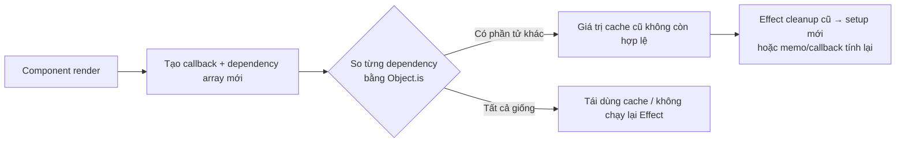

<Callout type="info" title="Mục tiêu phỏng vấn">

Dependency array không phải danh sách “những thứ muốn theo dõi”. Nó là bản khai báo các **giá trị reactive mà hook đã đọc**. Hiểu sai điểm này dẫn đến stale closure, kết nối không cleanup, fetch dữ liệu cũ và `useMemo` vô hiệu.

</Callout>

## Mục lục

- [Câu trả lời trong 30 giây](#câu-trả-lời-trong-30-giây)
- [Dependency array là gì?](#dependency-array-là-gì)
- [Giá trị nào là reactive?](#giá-trị-nào-là-reactive)
- [Hook nào nhận dependency array?](#hook-nào-nhận-dependency-array)
- [React so sánh dependencies như thế nào?](#react-so-sánh-dependencies-như-thế-nào)
- [Ba dạng của useEffect](#ba-dạng-của-useeffect)
  - [Không truyền array](#không-truyền-array)
  - [Array rỗng](#array-rỗng)
  - [Array có dependencies](#array-có-dependencies)
- [Cách tìm dependency đúng](#cách-tìm-dependency-đúng)
- [Stale closure: lỗi quan trọng nhất](#stale-closure-lỗi-quan-trọng-nhất)
- [Đừng chống lại exhaustive-deps](#đừng-chống-lại-exhaustive-deps)
- [Sáu cách loại dependency đúng](#sáu-cách-loại-dependency-đúng)
  - [1. Dùng functional updater](#1-dùng-functional-updater)
  - [2. Đặt object hoặc function vào trong Effect](#2-đặt-object-hoặc-function-vào-trong-effect)
  - [3. Tách Effect theo từng quá trình đồng bộ](#3-tách-effect-theo-từng-quá-trình-đồng-bộ)
  - [4. Chuyển logic do thao tác người dùng sang event handler](#4-chuyển-logic-do-thao-tác-người-dùng-sang-event-handler)
  - [5. Đọc giá trị mới nhất không reactive bằng useEffectEvent](#5-đọc-giá-trị-mới-nhất-không-reactive-bằng-useeffectevent)
  - [6. Đưa hằng số ổn định ra ngoài component](#6-đưa-hằng-số-ổn-định-ra-ngoài-component)
- [Object, function và referential equality](#object-function-và-referential-equality)
- [Refs, module variable và dependency array](#refs-module-variable-và-dependency-array)
- [Effect cleanup và request bất đồng bộ](#effect-cleanup-và-request-bất-đồng-bộ)
- [Dependency array của useMemo, useCallback và useImperativeHandle](#dependency-array-của-usememo-usecallback-và-useimperativehandle)
- [Bảng quyết định nhanh](#bảng-quyết-định-nhanh)
- [Câu trả lời mẫu hoàn chỉnh](#câu-trả-lời-mẫu-hoàn-chỉnh)
- [Câu hỏi đào sâu thường gặp](#câu-hỏi-đào-sâu-thường-gặp)
- [Tài liệu tham khảo](#tài-liệu-tham-khảo)

---

## Câu trả lời trong 30 giây

Dependency array là đối số thứ hai của một số Hook như `useEffect`, `useMemo` và `useCallback`. Nó liệt kê mọi **giá trị reactive** — props, state, hoặc biến/hàm được khai báo trong component — mà callback của Hook đang đọc.

Sau mỗi render, React so sánh từng dependency mới với dependency cũ bằng `Object.is`. Nếu có phần tử khác, Effect chạy lại sau commit; `useMemo` tính lại; `useCallback` trả về function mới. Nếu tất cả giống nhau, React tái dùng kết quả trước đó hoặc không chạy lại Effect.

Không được tự ý bỏ dependency để Effect “chạy một lần”. Việc đó tạo **stale closure**: callback giữ props/state của render cũ. Cách sửa là thay đổi cấu trúc code — dùng functional updater, tạo object/function bên trong Effect, tách Effect, chuyển logic sang event handler, hoặc dùng `useEffectEvent` khi phù hợp — rồi để linter xác nhận array cuối cùng.

<Callout type="idea" title="Câu chốt nên nói">

Dependency array mô tả **callback này phụ thuộc vào dữ liệu nào**, chứ không phải lịch chạy mà ta muốn ép React thực hiện.

</Callout>

## Dependency array là gì?

Nhiều Hook nhận callback và cần biết khi nào callback cũ không còn hợp lệ. Dependency array là “chữ ký input” của callback đó.

```tsx
useEffect(() => {
  document.title = `${query} (${results.length})`;
}, [query, results.length]);
```

Effect đọc `query` và `results.length`. Khi một trong hai thay đổi, tiêu đề trang phải được đồng bộ lại. Những giá trị không được đọc không nên xuất hiện chỉ vì chúng có trong component.



Với Effect, callback không chạy trong render. React commit UI trước, sau đó cleanup Effect cũ (nếu cần) và chạy setup Effect mới. Với `useMemo` và `useCallback`, callback/cache được xử lý trong render để tạo giá trị cho lần render đó.

## Giá trị nào là reactive?

Trong component, các giá trị sau là **reactive** vì mỗi render có thể cung cấp giá trị khác:

- props, bao gồm object và function props;
- state và giá trị được tính từ state;
- biến, function và object được khai báo trực tiếp trong thân component;
- giá trị trả về từ custom Hook nếu callback đọc chúng.

```tsx
function ChatRoom({ roomId, onConnected }: Props) {
  const [serverUrl, setServerUrl] = useState('https://chat.example');
  const connectionKey = `${serverUrl}/${roomId}`;

  useEffect(() => {
    const connection = createConnection(connectionKey);
    connection.connect();
    onConnected();
    return () => connection.disconnect();
  }, [connectionKey, onConnected]);
}
```

`roomId`, `serverUrl`, `connectionKey` và `onConnected` đều có thể khác ở render tiếp theo. Trong ví dụ này Effect trực tiếp đọc `connectionKey` và `onConnected`, nên đây là dependencies cần khai báo. Không cần thêm `roomId` hay `serverUrl` **chỉ vì** chúng được dùng để tạo `connectionKey`; khi `connectionKey` đổi thì Effect đã chạy lại.

Ngược lại, hằng số module không reactive. Nó không được tạo lại khi component render:

```tsx
const API_ORIGIN = 'https://api.example.com';

function Products({ category }: { category: string }) {
  useEffect(() => {
    fetch(`${API_ORIGIN}/products?category=${category}`);
  }, [category]);
}
```

`API_ORIGIN` không cần dependency. Xem kỹ hơn phần [Refs, module variable và dependency array](#refs-module-variable-và-dependency-array).

## Hook nào nhận dependency array?

| Hook | Callback / giá trị được kiểm soát | Khi dependency thay đổi |
|---|---|---|
| `useEffect` | Đồng bộ với hệ thống ngoài sau khi commit | Cleanup cũ rồi chạy setup mới |
| `useLayoutEffect` | Đồng bộ/đo DOM trước khi browser paint | Cleanup cũ rồi chạy setup mới, chặn paint |
| `useInsertionEffect` | Chèn CSS trước layout effect | Chạy lại setup; dành cho thư viện CSS-in-JS |
| `useMemo` | Giá trị tính toán thuần | Tính lại giá trị |
| `useCallback` | Tham chiếu function | Tạo function mới |
| `useImperativeHandle` | Handle public cho `ref` | Tạo lại handle |

Các Hook như `useState`, `useReducer`, `useRef`, `useContext`, `useId`, `useTransition` hoặc `useSyncExternalStore` **không** nhận dependency array. Đừng cố thêm array vào chúng.

`useEffectEvent` cũng không nhận dependency array. Nó được thiết kế để tách một đoạn logic **không reactive** ra khỏi Effect, đồng thời đoạn logic đó vẫn đọc được props/state mới nhất. Đây không phải công cụ để lách linter; xem ví dụ ở phần sau.

## React so sánh dependencies như thế nào?

Array phải được viết inline, có độ dài không đổi giữa các lần render:

```tsx
useEffect(() => {
  // ...
}, [roomId, serverUrl]);
```

React so sánh từng vị trí bằng [`Object.is`](https://developer.mozilla.org/en-US/docs/Web/JavaScript/Reference/Global_Objects/Object/is), không so sánh sâu.

| So sánh | Kết quả |
|---|---|
| `Object.is('react', 'react')` | `true` |
| `Object.is(1, 1)` | `true` |
| `Object.is({ id: 1 }, { id: 1 })` | `false` — hai object khác reference |
| `Object.is(() => {}, () => {})` | `false` — hai function khác reference |
| `Object.is(NaN, NaN)` | `true` |
| `Object.is(0, -0)` | `false` |

Vì vậy dependency là object, array hay function được tạo mới ở mỗi render sẽ luôn được xem là thay đổi. Không viết dependency động như `condition ? [a] : [a, b]`: nó có độ dài khác nhau, làm nghĩa của callback mơ hồ và vi phạm quy tắc Hook.

## Ba dạng của useEffect

### Không truyền array

```tsx
useEffect(() => {
  syncWithExternalSystem();
});
```

Effect chạy sau **mọi lần commit**. Dạng này hiếm khi là điều bạn cần; nếu Effect set state thì rất dễ tạo vòng lặp render → Effect → set state → render.

### Array rỗng

```tsx
useEffect(() => {
  subscribeOnce();
  return () => unsubscribe();
}, []);
```

Effect chạy sau mount. Cleanup chạy khi unmount. Trong development với Strict Mode, React còn chạy một chu kỳ setup → cleanup → setup để kiểm tra cleanup.

Array rỗng **chỉ đúng** khi callback thực sự không đọc props/state/biến reactive nào. `[]` không có nghĩa “bỏ qua mọi dependency để chạy một lần”.

### Array có dependencies

```tsx
useEffect(() => {
  const connection = createConnection(serverUrl, roomId);
  connection.connect();
  return () => connection.disconnect();
}, [serverUrl, roomId]);
```

Effect chạy sau mount, rồi chạy lại khi `serverUrl` hoặc `roomId` thay đổi. Trước lần setup mới, React gọi cleanup với các giá trị đã được closure của Effect cũ ghi nhớ.

## Cách tìm dependency đúng

Đừng đoán theo tên Hook. Làm theo quy trình này cho từng callback:

<Steps>
  <Step>

### Khoanh vùng callback

Xem phần thân callback của `useEffect`, hàm tính trong `useMemo`, function trong `useCallback`, hoặc factory của `useImperativeHandle`. Chỉ dữ liệu callback đọc mới liên quan.

  </Step>
  <Step>

### Liệt kê mọi giá trị từ render scope

Tìm props, state, object/function và biến được khai báo trong component mà callback tham chiếu. Đây là các ứng viên reactive.

  </Step>
  <Step>

### Phân biệt giá trị ổn định

Bỏ module constant, import, và setter của `useState`/`useReducer` vì chúng ổn định. Đừng thêm `ref.current`: React không render lại khi nó đổi, nên dependency đó không tạo ra sự đồng bộ đáng tin cậy.

  </Step>
  <Step>

### Để exhaustive-deps kiểm tra

Bật rule `react-hooks/exhaustive-deps` và sửa nguyên nhân của cảnh báo. Rule phân tích closure tốt hơn việc tự đếm bằng mắt, đặc biệt trong custom Hook.

  </Step>
</Steps>

Ví dụ:

```tsx
function SearchResults({ query, locale }: Props) {
  const [page, setPage] = useState(1);

  useEffect(() => {
    loadResults({ query, page, locale });
  }, [query, page, locale]);
}
```

Effect đọc ba giá trị reactive, nên array gồm đúng ba giá trị đó. Setter `setPage` không được đọc, và cũng ổn định nếu có được đọc.

## Stale closure: lỗi quan trọng nhất

Mỗi lần render tạo một closure mới. Callback của Hook “nhìn thấy” props/state của render đã tạo ra nó. Nếu array bỏ sót dependency, callback cũ tiếp tục chạy với dữ liệu cũ — đó là **stale closure**.

```tsx
function Counter() {
  const [count, setCount] = useState(0);

  useEffect(() => {
    const id = setInterval(() => {
      console.log(count);
    }, 1000);
    return () => clearInterval(id);
  }, []); // ❌ count luôn là 0 của lần render đầu

  return <button onClick={() => setCount((value) => value + 1)}>{count}</button>;
}
```

Thêm `count` vào array làm interval mới được tạo sau mỗi lần đếm. Điều này đúng về mặt dữ liệu, nhưng chưa chắc là cấu trúc tốt nhất nếu mục tiêu là **cập nhật state từ state cũ**.

```tsx
function Counter() {
  const [count, setCount] = useState(0);

  useEffect(() => {
    const id = setInterval(() => {
      setCount((value) => value + 1);
    }, 1000);
    return () => clearInterval(id);
  }, []); // ✅ callback không còn đọc count

  return <p>{count}</p>;
}
```

Functional updater nhận state mới nhất từ React, nên Effect không còn phụ thuộc vào `count`. Đây là sửa thiết kế, không phải xóa dependency để im linter.

## Đừng chống lại exhaustive-deps

`eslint-plugin-react-hooks` có rule `react-hooks/exhaustive-deps`. Khi nó báo thiếu dependency, mặc định hãy coi đó là cảnh báo về **logic không đồng bộ với dữ liệu**, không phải lỗi format.

```tsx
// ❌ Che cảnh báo: Effect không theo roomId mới.
useEffect(() => {
  joinRoom(roomId);
}, []); // eslint-disable-line react-hooks/exhaustive-deps

// ✅ Khai báo đúng lifecycle của kết nối.
useEffect(() => {
  const room = joinRoom(roomId);
  return () => room.leave();
}, [roomId]);
```

Có lúc linter đề xuất thêm một object/function khiến Effect chạy liên tục. Điều đó không chứng minh linter sai. Nó cho biết object/function này đang được tạo trong render scope và callback thật sự đọc nó. Hãy tái cấu trúc theo các cách ở phần tiếp theo.

<Callout type="warn" title="Không dùng dependency array làm công tắc lịch chạy">

Các mẫu như `// eslint-disable`, `[]` khi callback đọc props/state, hay xóa dependency để tránh fetch lại chỉ trì hoãn bug. Khi input đổi, Effect vẫn dùng dữ liệu cũ; khi unmount, cleanup có thể dọn sai subscription cũ.

</Callout>

## Sáu cách loại dependency đúng

### 1. Dùng functional updater

Nếu chỉ đọc state để tính state kế tiếp, giao công thức cho setter. Callback không cần đóng lên state hiện tại.

```tsx
// ❌ todos là dependency chỉ vì cần tạo state kế tiếp.
const addTodo = useCallback((text: string) => {
  setTodos([...todos, { id: nextId++, text }]);
}, [todos]);

// ✅ React cung cấp todos mới nhất cho updater.
const addTodo = useCallback((text: string) => {
  setTodos((todos) => [...todos, { id: nextId++, text }]);
}, []);
```

Trong code production, tránh `nextId++` là biến module mutable nếu ID có yêu cầu chặt chẽ; ví dụ này chỉ minh họa việc bỏ `todos` khỏi closure.

### 2. Đặt object hoặc function vào trong Effect

Object/function chỉ phục vụ Effect không cần sống ở render scope.

```tsx
// ❌ options là object mới mỗi render, nên Effect chạy mỗi render.
function ChatRoom({ roomId }: { roomId: string }) {
  const options = { serverUrl: 'https://chat.example', roomId };

  useEffect(() => {
    const connection = createConnection(options);
    connection.connect();
    return () => connection.disconnect();
  }, [options]);
}

// ✅ Effect chỉ phụ thuộc giá trị primitive thật sự.
function ChatRoom({ roomId }: { roomId: string }) {
  useEffect(() => {
    const options = { serverUrl: 'https://chat.example', roomId };
    const connection = createConnection(options);
    connection.connect();
    return () => connection.disconnect();
  }, [roomId]);
}
```

Đừng mặc định bọc `options` bằng `useMemo`. Đưa nó vào Effect thường đơn giản hơn và tránh biến `useMemo` thành dependency của correctness.

### 3. Tách Effect theo từng quá trình đồng bộ

Một Effect nên đồng bộ **một** hệ thống ngoài với React. Nếu hai tác vụ có dependencies khác nhau, tách chúng để một thay đổi không kéo theo tác vụ không liên quan.

```tsx
// ✅ Analytics chỉ phụ thuộc page; kết nối chỉ phụ thuộc roomId.
useEffect(() => {
  logPageView(page);
}, [page]);

useEffect(() => {
  const connection = connectToRoom(roomId);
  return () => connection.disconnect();
}, [roomId]);
```

Gộp cả hai vào `[page, roomId]` sẽ reconnect phòng chat mỗi lần người dùng đổi trang không liên quan.

### 4. Chuyển logic do thao tác người dùng sang event handler

Effect dùng để đồng bộ với thứ **vì UI đã hiển thị** mà cần chạy. Nếu công việc chỉ xảy ra vì người dùng bấm nút, đặt nó ngay trong event handler.

```tsx
// ❌ Side effect thực chất thuộc về thao tác submit.
useEffect(() => {
  if (submitted) postOrder(productId);
}, [submitted, productId]);

// ✅ Event handler biết chính xác vì sao cần gửi đơn.
function handleSubmit() {
  postOrder(productId);
}
```

Cách này bỏ state trung gian `submitted`, giảm dependencies và tránh gửi lại đơn khi `productId` đổi sau khi người dùng đã submit.

### 5. Đọc giá trị mới nhất không reactive bằng useEffectEvent

Đôi khi Effect phải chạy lại theo một giá trị, nhưng callback bên trong cần đọc giá trị mới nhất khác mà **không** làm Effect chạy lại. React 19 cung cấp `useEffectEvent` cho ranh giới này.

```tsx
import { useEffect, useEffectEvent } from 'react';

function ChatRoom({ roomId, theme }: { roomId: string; theme: string }) {
  const onConnected = useEffectEvent(() => {
    showNotification('Đã kết nối', theme);
  });

  useEffect(() => {
    const connection = createConnection(roomId);
    connection.on('connected', onConnected);
    connection.connect();
    return () => connection.disconnect();
  }, [roomId]); // theme không làm reconnect
}
```

`onConnected` không được gọi từ event handler hay truyền xuống child. Nó chỉ nên được gọi bên trong Effect. Linter React hiện đại hiểu Effect Event và không yêu cầu đưa nó vào dependency array.

<Callout type="info" title="Khi chưa dùng useEffectEvent">

Đừng thay thế máy móc bằng `useRef`. Ref có thể hợp cho một số integration imperative, nhưng dễ che đi luồng dữ liệu. Trước hết thử tách Effect hoặc đưa logic vào event handler; dùng ref khi bạn thực sự cần giá trị mutable không render.

</Callout>

### 6. Đưa hằng số ổn định ra ngoài component

Nếu một cấu hình thật sự bất biến đối với mọi instance, khai báo ở module scope để chứng minh nó không reactive.

```tsx
const SERVER_URL = 'https://chat.example';

function ChatRoom({ roomId }: { roomId: string }) {
  useEffect(() => {
    const connection = createConnection(SERVER_URL, roomId);
    connection.connect();
    return () => connection.disconnect();
  }, [roomId]);
}
```

Chỉ làm vậy với hằng số không phụ thuộc props, state hoặc context. Không đưa biến phụ thuộc người dùng ra module scope để “né dependency”; nó sẽ làm nhiều component instance dùng chung state sai cách.

## Object, function và referential equality

Mỗi lần function component chạy, object literal, array literal và function literal bên trong nó thường có reference mới.

```tsx
function Search({ query }: { query: string }) {
  const filters = { query }; // object mới ở mỗi render

  useEffect(() => {
    fetchResults(filters);
  }, [filters]); // Effect chạy mỗi render
}
```

Có ba lựa chọn, theo thứ tự ưu tiên thông thường:

1. **Tạo object trong Effect** nếu nó chỉ phục vụ Effect.
2. **Phụ thuộc trực tiếp vào primitive** như `query` nếu API cho phép.
3. **`useMemo` object hoặc `useCallback` function** nếu cùng reference thực sự cần được chia sẻ với `memo` child hoặc Hook khác.

```tsx
function Search({ query }: { query: string }) {
  useEffect(() => {
    fetchResults({ query });
  }, [query]); // ✅
}
```

`useMemo`/`useCallback` có dependency array của chính chúng. Nếu deps của memo sai, object/function ổn định nhưng lại chứa dữ liệu stale. Vì vậy memoization không thay thế việc hiểu data flow.

Xem thêm [Referential Equality](/toi-uu-rerender/referential-equality/) và [useMemo & useCallback](/toi-uu-rerender/usememo-usecallback/).

## Refs, module variable và dependency array

`ref.current` là dữ liệu mutable nhưng không reactive: thay đổi nó không trigger render. React không thể biết chính xác khi nào để chạy lại Effect chỉ từ `ref.current`.

```tsx
function VideoPlayer({ isPlaying }: { isPlaying: boolean }) {
  const videoRef = useRef<HTMLVideoElement>(null);

  useEffect(() => {
    if (isPlaying) videoRef.current?.play();
    else videoRef.current?.pause();
  }, [isPlaying]); // ✅ Không thêm videoRef.current
}
```

Bản thân object ref từ `useRef` ổn định trong vòng đời component. Linter thường không yêu cầu thêm ref vào array. Nếu custom Hook nhận `ref` như một prop, thêm `ref` vào array là an toàn vì hook không thể chứng minh object đó ổn định ở nơi gọi.

Tương tự, module variable/import không phải dependency reactive:

```tsx
import { analytics } from './analytics';

const RETRY_DELAY = 500;
```

Chúng không đổi theo từng render component. Nếu bạn **muốn** thay đổi một giá trị và UI/Effect phải phản ứng theo thay đổi ấy, giá trị đó phải là state, prop, context hoặc external store được React đăng ký — không phải biến module hay ref.

## Effect cleanup và request bất đồng bộ

Dependencies không chỉ quyết định setup. Chúng quyết định lúc cleanup của setup cũ phải chạy. Một subscription thiếu dependency có thể tiếp tục nghe room cũ sau khi `roomId` đã đổi.

```tsx
useEffect(() => {
  const connection = createConnection(roomId);
  connection.connect();

  return () => connection.disconnect();
}, [roomId]);
```

Khi `roomId` đổi, thứ tự là:

```text
commit UI với roomId mới
→ cleanup đóng kết nối roomId cũ
→ setup mở kết nối roomId mới
```

Với fetch, callback Effect không nên là `async`, vì `useEffect` cần callback trả về `undefined` hoặc một hàm cleanup, không phải Promise. Tạo hàm async bên trong và hủy request cũ trong cleanup.

```tsx
useEffect(() => {
  const controller = new AbortController();

  async function load() {
    const response = await fetch(`/api/products?q=${query}`, {
      signal: controller.signal,
    });
    const data = await response.json();
    setProducts(data);
  }

  void load();
  return () => controller.abort();
}, [query]);
```

`query` nằm trong array để request mới được tạo khi query đổi. `AbortController` bảo đảm response chậm của request cũ không tiếp tục cập nhật state sau khi Effect đã bị thay thế.

## Dependency array của useMemo, useCallback và useImperativeHandle

Cùng phép so sánh `Object.is`, nhưng mục đích của callback khác nhau.

| Hook | Callback nên làm gì | Hậu quả khi thiếu dependency |
|---|---|---|
| `useEffect` | Đồng bộ/cleanup hệ thống ngoài | Subscription, request hoặc timer dùng dữ liệu cũ |
| `useMemo` | Tính giá trị thuần | Kết quả cache stale |
| `useCallback` | Giữ identity function khi cần | Function gọi props/state cũ |
| `useImperativeHandle` | Tạo API imperative cho ref | Parent nhận handle gọi logic cũ |

```tsx
const visibleItems = useMemo(() => {
  return items.filter((item) => item.name.includes(query));
}, [items, query]);

const handleSave = useCallback(() => {
  saveDocument(documentId, draft);
}, [documentId, draft]);

useImperativeHandle(ref, () => ({
  focus() {
    inputRef.current?.focus();
  },
  clear() {
    setValue('');
  },
}), []); // Không đọc reactive value; setter ổn định.
```

`useMemo` và `useCallback` là tối ưu hiệu năng, không phải công cụ để quyết định tính đúng đắn của ứng dụng. Một Effect cần object/function ổn định thường nên được tái cấu trúc trước; chỉ memo hóa khi bạn đã có nhu cầu identity rõ ràng.

## Bảng quyết định nhanh

| Tình huống | Cách xử lý đúng |
|---|---|
| Effect đọc prop `roomId` | Đưa `roomId` vào array |
| Effect đọc state chỉ để tính state mới | Dùng functional updater, rồi bỏ state khỏi callback |
| Object chỉ được dùng trong Effect | Tạo object bên trong Effect, phụ thuộc các primitive |
| Function chỉ dùng trong Effect | Khai báo function trong Effect hoặc gọi trực tiếp |
| Hai external system có input khác nhau | Tách thành hai Effect |
| Logic chỉ do click/submit khởi phát | Đặt trong event handler |
| Cần đọc theme mới nhất nhưng không reconnect | Cân nhắc `useEffectEvent` |
| Muốn “chạy một lần” nhưng đọc props/state | Thiết kế lại; `[]` hiện tại là sai |
| Dependency là `ref.current` | Không thêm; dùng state nếu thay đổi cần trigger Effect |
| Linter báo thiếu dependency | Thêm dependency hoặc tái cấu trúc code; không disable mù quáng |

## Câu trả lời mẫu hoàn chỉnh

> Dependency array khai báo toàn bộ giá trị reactive mà callback của Hook đọc. Với `useEffect`, khi một dependency đổi theo `Object.is`, React cleanup Effect cũ rồi chạy Effect mới sau commit. Với `useMemo` và `useCallback`, nó quyết định khi nào cache hoặc function identity phải được tạo lại.
>
> Giá trị reactive là props, state và các biến/hàm tạo trong component. Hằng số module, import, setter state và `ref.current` không phải dependency reactive. Array rỗng chỉ đúng khi callback không đọc giá trị reactive nào; nếu không sẽ tạo stale closure.
>
> Khi exhaustive-deps cảnh báo, tôi không xóa dependency để ép lịch chạy. Tôi kiểm tra lại data flow: dùng functional updater, tạo object/function bên trong Effect, tách Effect, chuyển logic sang event handler hoặc dùng Effect Event nếu cần đọc giá trị mới nhất mà không muốn resubscribe.

## Câu hỏi đào sâu thường gặp

<Accordions type="single">
  <Accordion title="Vì sao React không tự suy ra dependency array?">
    React Compiler có thể tự động memo hóa nhiều biểu thức khi dự án bật Compiler. Nhưng Hook Effect vẫn cần biểu đạt rõ reactive input của quá trình đồng bộ, và code JavaScript động khiến việc suy luận tổng quát ở runtime không đáng tin cậy. Dependency array cùng exhaustive-deps tạo hợp đồng tường minh, có thể kiểm tra tĩnh.
  </Accordion>
  <Accordion title="Có phải mọi biến dùng trong Effect đều phải ở dependency array?">
    Mọi giá trị reactive dùng trong Effect thì có. Import, module constant, setter state/reducer ổn định không cần. `ref.current` cũng không phải dependency hữu ích vì thay đổi nó không làm React render. Linter giúp phân biệt các trường hợp này.
  </Accordion>
  <Accordion title="Tại sao thêm một function vào deps lại gây vòng lặp?">
    Function khai báo trong component có identity mới mỗi render. Effect thấy function đổi, chạy lại; nếu Effect set state thì lại render và tạo function mới. Sửa bằng cách đưa function vào Effect, dùng event handler, hoặc useCallback khi identity ổn định thật sự cần thiết.
  </Accordion>
  <Accordion title="Dùng useCallback để sửa mọi cảnh báo function dependency có đúng không?">
    Không. useCallback thêm một lớp dependency array khác cần bảo trì. Nếu function chỉ được gọi trong Effect, khai báo nó trong Effect thường đúng và đơn giản hơn. Dùng useCallback khi identity của function phải ổn định cho memoized child hoặc Hook khác.
  </Accordion>
  <Accordion title="Effect cleanup dùng roomId cũ hay mới?">
    Cleanup thuộc về closure của Effect cũ, nên nó đóng đúng kết nối của roomId cũ. Sau cleanup, React chạy setup mới với roomId mới. Đây là lý do dependency chính xác rất quan trọng cho subscription.
  </Accordion>
  <Accordion title="Strict Mode có làm dependency array thay đổi ý nghĩa không?">
    Không. Trong development, Strict Mode cố ý thêm chu kỳ setup → cleanup → setup lúc mount để phát hiện Effect thiếu cleanup. Array vẫn mô tả reactive values như production; code phải chịu được Effect được setup/cleanup nhiều lần.
  </Accordion>
</Accordions>

## Tài liệu tham khảo

- [React — `useEffect`](https://react.dev/reference/react/useEffect)
- [React — Lifecycle of Reactive Effects](https://react.dev/learn/lifecycle-of-reactive-effects)
- [React — Removing Effect Dependencies](https://react.dev/learn/removing-effect-dependencies)
- [React — Separating Events from Effects](https://react.dev/learn/separating-events-from-effects)
- [React — `useEffectEvent`](https://react.dev/reference/react/useEffectEvent)
- [React — `useMemo`](https://react.dev/reference/react/useMemo)
- [React — `useCallback`](https://react.dev/reference/react/useCallback)
- [React — eslint-plugin-react-hooks](https://react.dev/reference/eslint-plugin-react-hooks)
- [useMemo & useCallback](/toi-uu-rerender/usememo-usecallback/)
- [Referential Equality](/toi-uu-rerender/referential-equality/)
