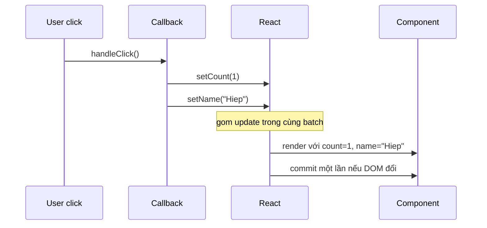
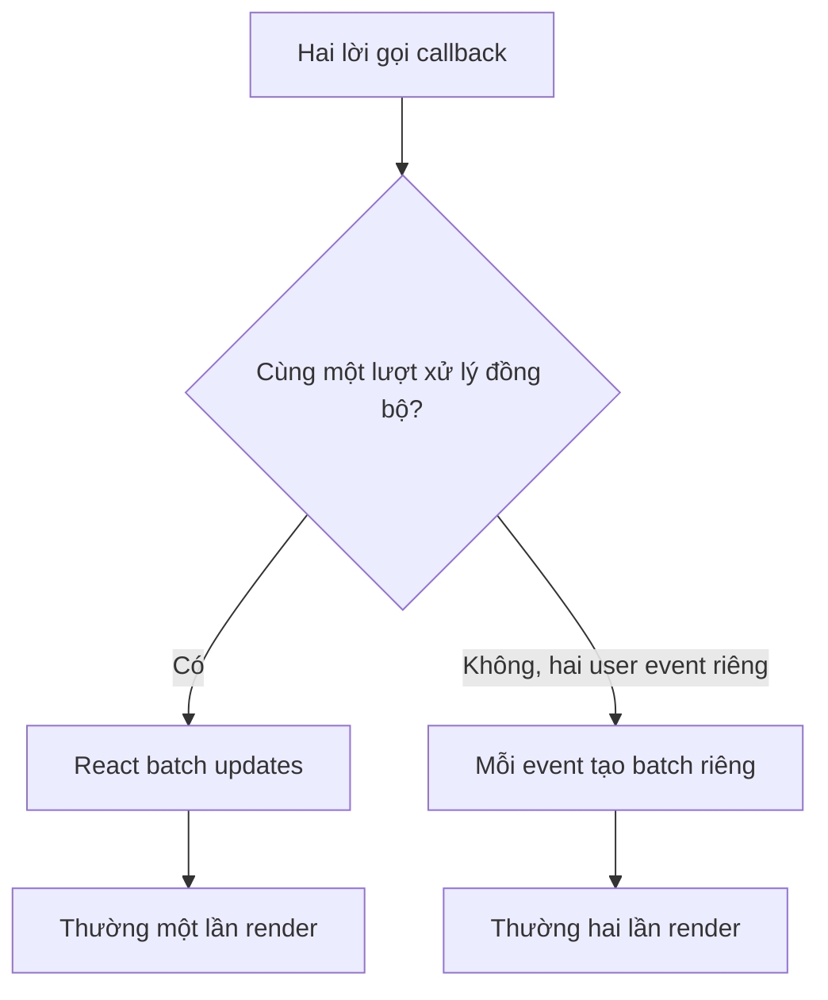
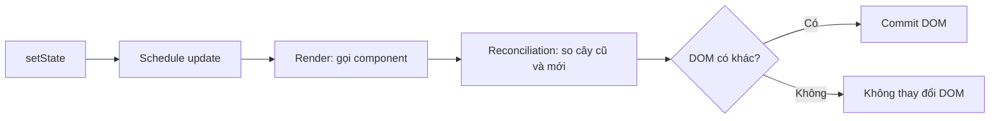

<Callout type="info" title="Câu hỏi phỏng vấn thường gặp">
  “Trong một <code>useCallback</code>, nếu gọi hai <code>setState</code> với giá trị khác nhau thì component re-render mấy lần?” Câu trả lời tốt phải tách rõ vai trò của <code>useCallback</code> và cơ chế batching của React.
</Callout>

## Mục lục

- [Câu trả lời trong 30 giây](#câu-trả-lời-trong-30-giây)
- [1. useCallback không kiểm soát số lần render](#1-usecallback-không-kiểm-soát-số-lần-render)
- [2. Automatic batching: hai update đồng bộ, một lần render](#2-automatic-batching-hai-update-đồng-bộ-một-lần-render)
  - [2.1 Hai state khác nhau](#21-hai-state-khác-nhau)
  - [2.2 Cùng một state được set hai lần](#22-cùng-một-state-được-set-hai-lần)
  - [2.3 Functional update được xử lý theo hàng đợi](#23-functional-update-được-xử-lý-theo-hàng-đợi)
- [3. Một callback bị gọi hai lần thì sao?](#3-một-callback-bị-gọi-hai-lần-thì-sao)
- [4. Khi nào thành nhiều lần render?](#4-khi-nào-thành-nhiều-lần-render)
  - [4.1 Hai user event riêng biệt](#41-hai-user-event-riêng-biệt)
  - [4.2 await tạo một ranh giới bất đồng bộ](#42-await-tạo-một-ranh-giới-bất-đồng-bộ)
  - [4.3 flushSync chủ động ép commit](#43-flushsync-chủ-động-ép-commit)
- [5. State không đổi và bailout](#5-state-không-đổi-và-bailout)
- [6. Render không đồng nghĩa DOM đổi](#6-render-không-đồng-nghĩa-dom-đổi)
- [7. Strict Mode làm log xuất hiện hai lần](#7-strict-mode-làm-log-xuất-hiện-hai-lần)
- [8. Bảng quyết định nhanh](#8-bảng-quyết-định-nhanh)
- [9. Câu trả lời mẫu hoàn chỉnh](#9-câu-trả-lời-mẫu-hoàn-chỉnh)
- [10. Câu hỏi gài thường gặp](#10-câu-hỏi-gài-thường-gặp)
- [Tài liệu tham khảo](#tài-liệu-tham-khảo)

---

## Câu trả lời trong 30 giây

Trong React 18+, nếu **hai lời gọi `setState` xảy ra đồng bộ trong cùng một lượt xử lý** — ví dụ bên trong một event handler hoặc một `useCallback` được gọi từ event handler đó — React thường **batch** chúng và component chỉ **render lại một lần** với toàn bộ state mới.

```tsx
const handleClick = useCallback(() => {
  setCount(1);
  setName('Hiep');
}, []);
```

Khi `handleClick` chạy, `count` và `name` cùng được cập nhật trong **một lần render**.

Điểm cần nhấn mạnh: `useCallback` không làm batching. Nó chỉ cache **tham chiếu của hàm**. Lý do có một lần render là **automatic batching** của React.

<Callout type="idea" title="Câu chốt nên nói">
  <code>useCallback</code> giữ identity của function; <strong>automatic batching</strong> gom nhiều state update đồng bộ thành một lần render. Nếu callback bị gọi ở hai user event khác nhau hoặc bị ngắt bởi <code>await</code>, có thể có nhiều lần render.
</Callout>

## 1. useCallback không kiểm soát số lần render

`useCallback` trả lại cùng một object function giữa các render, miễn là dependencies không đổi.

```tsx
const handleSave = useCallback(() => {
  // logic xử lý
}, [documentId]);
```

Nó hữu ích khi:

- truyền callback xuống component đã bọc `React.memo`, để prop function không đổi reference vô ích;
- dùng callback làm dependency của `useEffect` hoặc custom hook;
- một API yêu cầu unsubscribe bằng đúng function reference đã subscribe.

Nó **không** có các tác dụng sau:

- không ngăn component đang chứa nó render lại;
- không tự gom nhiều `setState`;
- không làm callback chạy ít lần hơn;
- không bảo đảm component con không render nếu các props khác vẫn đổi.

Hai đoạn sau có cùng hành vi batching:

```tsx
// Không có useCallback
function handleClick() {
  setCount(1);
  setName('Hiep');
}
```

```tsx
// Có useCallback
const handleClick = useCallback(() => {
  setCount(1);
  setName('Hiep');
}, []);
```

Trong cả hai trường hợp, nếu hàm được gọi đồng bộ trong cùng event, React batch hai update thành một render.

## 2. Automatic batching: hai update đồng bộ, một lần render

**Batching** là việc React thu thập nhiều state update trước, xử lý chúng cùng nhau, rồi render UI một lần thay vì render sau từng setter. React 18 tự động batching trong nhiều ngữ cảnh, gồm React event handler, `setTimeout`, Promise callback và native event handler.



### 2.1 Hai state khác nhau

Đây là trường hợp trực tiếp nhất.

```tsx
function Profile() {
  const [name, setName] = useState('An');
  const [isEditing, setIsEditing] = useState(true);

  const handleSave = useCallback(() => {
    setName('Bình');
    setIsEditing(false);
  }, []);

  console.log('Profile render');

  return <button onClick={handleSave}>Lưu</button>;
}
```

Sau một click, hàng đợi có hai update: `name = 'Bình'` và `isEditing = false`. React tính state cuối cùng rồi gọi `Profile` lại **một lần** với cả hai giá trị mới.

Không có trạng thái giao diện trung gian kiểu “tên đã là Bình nhưng form vẫn mở”, trừ khi bạn cố ý tách updates sang các lượt xử lý khác nhau.

### 2.2 Cùng một state được set hai lần

Nếu hai setter nhắm đến cùng một state với giá trị trực tiếp, update sau cùng quyết định state cuối:

```tsx
const handleClick = useCallback(() => {
  setCount(1);
  setCount(2);
}, []);
```

React vẫn xử lý trong một batch, nên thông thường có **một lần render**. Trong lần render đó, `count` là `2`.

```text
state cũ: 0
queue:     set 1 → set 2
state mới: 2
render:    một lần với count = 2
```

Setter đầu tiên không “render ra màn hình” rồi mới đến setter thứ hai. Nó chỉ là một update trong queue mà React xử lý trước khi render.

### 2.3 Functional update được xử lý theo hàng đợi

Đây là lý do cần dùng functional update khi state mới phụ thuộc state cũ:

```tsx
const handleClick = useCallback(() => {
  setCount((current) => current + 1);
  setCount((current) => current + 1);
}, []);
```

Nếu `count` đang là `0`, state cuối là `2`, và vẫn thường chỉ có **một lần render**.

```text
state cũ: 0
update 1: current => current + 1  → 1
update 2: current => current + 1  → 2
state mới: 2
```

Ngược lại, đoạn dùng snapshot `count` của render hiện tại không cộng hai lần:

```tsx
const handleClick = useCallback(() => {
  setCount(count + 1);
  setCount(count + 1);
}, [count]);
```

Nếu `count` là `0`, cả hai update đều yêu cầu `setCount(1)`. Kết quả cuối là `1`, không phải `2`. Đây là vấn đề **state là snapshot**: biến `count` trong callback không đổi ngay sau `setCount`.

<Callout type="warn" title="Đừng gọi setter là cập nhật biến ngay lập tức">
  <code>setCount</code> không đổi giá trị <code>count</code> trong callback đang chạy. Nó đưa update vào queue của React. Khi state tiếp theo phụ thuộc state trước, dùng <code>setCount(current =&gt; ...)</code>.
</Callout>

## 3. Một callback bị gọi hai lần thì sao?

Cần hỏi lại: “Hai lần” xảy ra trong **cùng một lượt xử lý đồng bộ** hay là hai thao tác riêng của user?

```tsx
const increment = useCallback(() => {
  setCount((current) => current + 1);
}, []);

function handleClick() {
  increment();
  increment();
}
```

Ở đây `increment()` được gọi hai lần **đồng bộ bên trong cùng click handler**. React gom cả hai updates; `count` tăng 2 và component thường render **một lần**.

```tsx
<button onClick={increment}>+1</button>
```

Nếu người dùng click nút hai lần, mỗi click là một **discrete event** (user event độc lập). React xử lý xong UI của click đầu trước khi xử lý click sau để UI không bị sai, vì vậy thông thường có **hai lần render** nếu mỗi lần đều làm state đổi.



## 4. Khi nào thành nhiều lần render?

Batching không có nghĩa mọi state update trong toàn bộ vòng đời ứng dụng sẽ thành một render. React có ranh giới batch để UI được cập nhật đúng thời điểm.

### 4.1 Hai user event riêng biệt

Hai click, hai lần submit, hoặc hai lần gõ phím là các event riêng biệt.

```tsx
const increment = useCallback(() => {
  setCount((current) => current + 1);
}, []);
```

- Click lần 1: `count` từ `0` thành `1` → một render.
- Click lần 2: `count` từ `1` thành `2` → một render khác.

React không nên gom hai click thành một lần, vì button phải kịp phản ánh trạng thái sau click đầu trước khi user thực hiện click tiếp theo.

### 4.2 await tạo một ranh giới bất đồng bộ

`await` tách async function thành phần trước và sau khi Promise hoàn thành. React không batch state update xuyên qua ranh giới `await` theo cách bạn nên dựa vào.

```tsx
const handleSave = useCallback(async () => {
  setStatus('saving'); // batch thứ nhất → thường render 1

  await saveToServer();

  setStatus('saved');  // batch khác → thường render 2
}, []);
```

Hai render ở đây thường là đúng UX: người dùng cần thấy trạng thái `saving` trước khi request hoàn thành, sau đó mới thấy `saved`.

<Callout type="info" title="Promise callback không phải luôn tạo hai render">
  Hai <code>setState</code> nằm trong <strong>cùng một</strong> callback của <code>Promise.then</code> hoặc <code>setTimeout</code> vẫn được React 18 batch. Điểm tách quan trọng trong ví dụ là bản thân <code>await</code> chia code thành hai lượt thực thi.
</Callout>

### 4.3 flushSync chủ động ép commit

`flushSync` từ `react-dom` buộc React flush update ngay. Nó là API hiếm dùng, dành cho tích hợp với browser API hoặc thư viện bên thứ ba cần DOM đã cập nhật đồng bộ.

```tsx
import { flushSync } from 'react-dom';

function handleClick() {
  flushSync(() => {
    setOpen(true); // render/commit ngay để DOM modal tồn tại
  });

  // Có thể focus một node modal ở đây nếu cần.
  setMessage('Đã mở'); // một batch sau đó, có thể tạo render khác
}
```

`flushSync` phá lợi ích batching và có thể làm app chậm. Đừng dùng nó chỉ để “chắc chắn state đã đổi”; hãy để React batch mặc định trừ khi một integration cụ thể thật sự yêu cầu DOM mới ngay lập tức.

## 5. State không đổi và bailout

Một state update được gọi không luôn dẫn tới một commit. React so sánh state mới với state hiện tại bằng `Object.is` và có thể **bailout** — bỏ qua phần công việc không cần thiết — nếu giá trị không đổi.

```tsx
const [status, setStatus] = useState<'idle' | 'loading'>('idle');

const handleClick = useCallback(() => {
  setStatus('idle'); // giá trị đã là idle
}, []);
```

Đoạn trên có thể không tạo thay đổi UI. Tuy nhiên, trong các tình huống có update đang chờ hoặc đặc điểm triển khai nội bộ, React có thể gọi component thêm một lần trước khi phát hiện có thể bailout. Vì vậy phát biểu chính xác trong phỏng vấn là:

> Nếu state mới bằng state cũ theo `Object.is`, React có thể bỏ qua render sâu/commit không cần thiết; đừng dựa vào số lần gọi hàm component như một hợp đồng tuyệt đối.

Với object và array, “nội dung giống nhau” không đủ; reference cũng phải giống:

```tsx
const [filters, setFilters] = useState({ category: 'all' });

setFilters(filters);                    // cùng reference → có thể bailout
setFilters({ category: 'all' });        // object mới → React xem là state mới
```

## 6. Render không đồng nghĩa DOM đổi

Một lần React gọi hàm component là **render phase**. Sau đó React so sánh cây element mới với cây trước đó. Chỉ khi tìm thấy thay đổi ở DOM host node thì React mới làm **commit**.



Vì thế `console.log` trong component không chứng minh DOM đã thay đổi, cũng không phải công cụ tốt để đo hiệu năng. Dùng React DevTools Profiler để xem render duration và commit thực tế.

## 7. Strict Mode làm log xuất hiện hai lần

Trong development, `<StrictMode>` có thể gọi component render nhiều hơn bạn dự đoán để phát hiện impurity và cleanup effect không đúng. Ví dụ một click có thể tạo nhiều dòng `console.log('render')` hơn production.

Đây không đồng nghĩa user nhìn thấy hai DOM commit, cũng không có nghĩa batching hỏng. Hãy kiểm tra production build hoặc dùng Profiler trước khi kết luận có render thừa.

<Callout type="warn" title="Đừng sửa Strict Mode bằng cách tắt nó">
  Strict Mode đang chỉ ra rằng render và effect cần an toàn khi bị gọi lại. Sửa side effect đặt sai chỗ hoặc cleanup thiếu thay vì tắt công cụ kiểm tra.
</Callout>

## 8. Bảng quyết định nhanh

| Tình huống | Số lần render thường thấy | State cuối | Vì sao |
|---|---:|---|---|
| Một callback gọi `setA(1)` và `setB(2)` đồng bộ | 1 | `a = 1`, `b = 2` | Automatic batching |
| Một callback gọi `setCount(1)` rồi `setCount(2)` | 1 | `count = 2` | Update sau ghi đè state trực tiếp trước đó |
| Hai functional update tăng count | 1 | `count + 2` | Queue xử lý từng updater theo thứ tự |
| Hai `setCount(count + 1)` cùng render snapshot | 1 | `count + 1` | Cả hai dùng cùng giá trị `count` cũ |
| Callback gọi hai lần trong cùng click handler | 1 | Tùy queue update | Cùng batch đồng bộ |
| User click hai lần | 2 | State đổi hai lần | Hai discrete event riêng |
| `setState` trước và sau `await` | Thường 2 | Trạng thái trước/sau async | `await` tạo ranh giới thực thi |
| Set cùng primitive value | 0 hoặc bailout | Không đổi | `Object.is` bằng nhau |
| Development với Strict Mode | Log có thể nhiều hơn | Theo state thật | Kiểm tra phát triển, không suy ra số commit |

## 9. Câu trả lời mẫu hoàn chỉnh

> `useCallback` không quyết định số lần re-render; nó chỉ giữ cùng reference cho function khi dependencies không đổi. Trong React 18, nếu callback gọi nhiều `setState` đồng bộ trong cùng event hoặc cùng callback, React automatic batch các update đó, nên component thường re-render một lần với state cuối cùng.
>
> Nếu set cùng state hai lần bằng giá trị trực tiếp, update sau cùng thắng. Nếu state mới phụ thuộc state cũ, tôi dùng functional update vì React xử lý các updater theo thứ tự trong queue. Ví dụ hai lần `setCount(c => c + 1)` tăng count hai nhưng vẫn chỉ cần một render.
>
> Số render có thể tăng nếu updates thuộc hai user event khác nhau, bị tách qua `await`, hoặc code dùng `flushSync`. Ngoài ra, render không đồng nghĩa DOM đổi; React chỉ commit khi output thật sự khác. Và log trong Strict Mode development có thể xuất hiện thêm do cơ chế kiểm tra của React.

## 10. Câu hỏi gài thường gặp

<Accordions type="single">
  <Accordion title="Có useCallback thì component có không re-render không?">
    Không. Component có state đổi vẫn render. useCallback chỉ giúp callback không đổi reference, hữu ích cho child đã memo hoặc dependency của hook khác.
  </Accordion>
  <Accordion title="Vì sao setCount(count + 1) hai lần chỉ tăng một?">
    count là snapshot của lần render đã tạo callback. Cả hai biểu thức đều tính cùng một giá trị tiếp theo. Dùng hai functional update để mỗi update nhận kết quả của update trước.
  </Accordion>
  <Accordion title="React 18 có batch update trong setTimeout và Promise không?">
    Có. Các updates đồng bộ trong cùng callback setTimeout hoặc Promise callback được automatic batch. Không nên gộp chúng nhầm với code trước/sau await, vốn thuộc hai lượt thực thi khác nhau.
  </Accordion>
  <Accordion title="Nếu React render một lần thì DOM chắc chắn chỉ sửa một lần?">
    Không nên diễn đạt tuyệt đối như vậy. Render là React tính output; commit chỉ áp phần khác biệt vào DOM. Một render có thể không làm DOM thay đổi gì.
  </Accordion>
  <Accordion title="Có nên dùng flushSync để mỗi setState có hiệu lực ngay?">
    Không. Nó là escape hatch cho integration cần DOM mới đồng bộ, không phải công cụ state flow thông thường. Dùng bừa làm mất batching và gây chậm.
  </Accordion>
</Accordions>

## Tài liệu tham khảo

- [React — Queueing a Series of State Updates](https://react.dev/learn/queueing-a-series-of-state-updates)
- [React — `useCallback`](https://react.dev/reference/react/useCallback)
- [React — `useState`](https://react.dev/reference/react/useState)
- [React — `flushSync`](https://react.dev/reference/react-dom/flushSync)
- [React — Strict Mode](https://react.dev/reference/react/StrictMode)
- [React 18 — Automatic Batching](https://github.com/reactwg/react-18/discussions/21)
- [Khi nào React quyết định re-render?](/interview-questions/khi-nao-react-quyet-dinh-rerender/)
- [Render Pipeline](/react-internals/render-pipeline/)
- [Vì sao component re-render?](/react-internals/vi-sao-component-rerender/)
