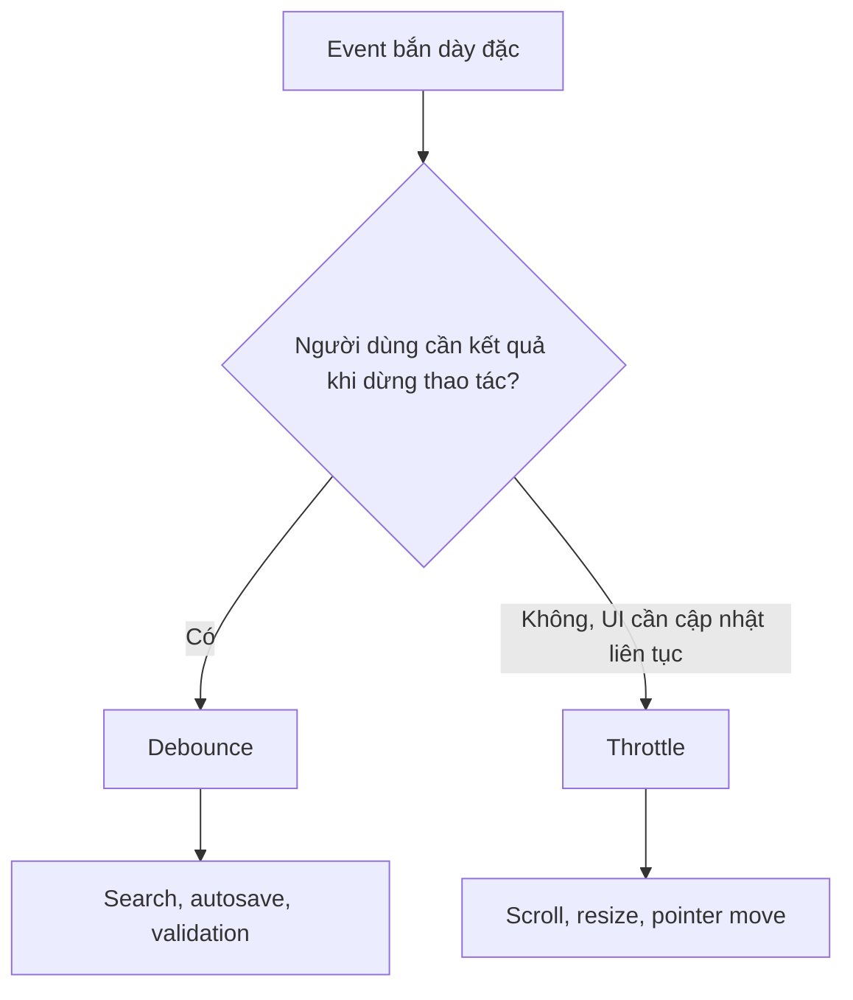
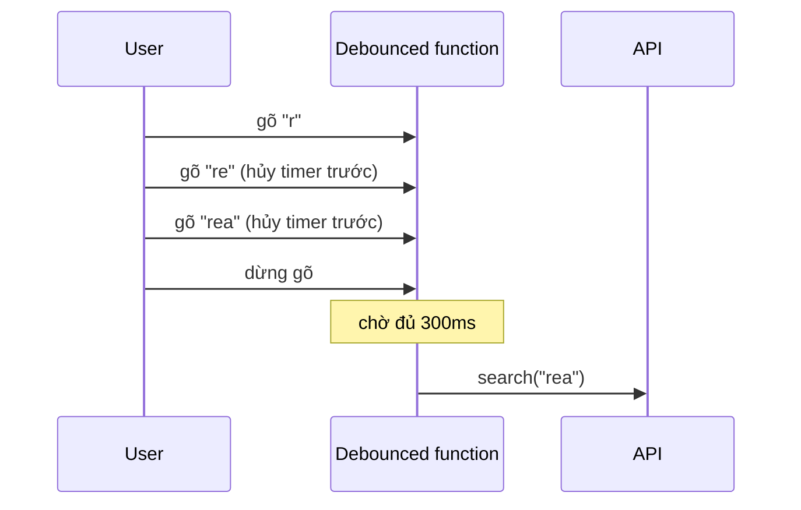

<Callout type="info" title="Phạm vi bài viết">
  Throttling và debouncing giảm <strong>số lần một hàm chạy</strong> khi event xảy ra dày đặc. Chúng không tự làm React render ít hơn, cũng không phải cơ chế bảo mật để giới hạn request ở server.
</Callout>

## Mục lục

- [Tổng quan](#tổng-quan)
- [1. Vấn đề: event có thể đến nhanh hơn code xử lý](#1-vấn-đề-event-có-thể-đến-nhanh-hơn-code-xử-lý)
- [2. Debounce: đợi đến khi yên lặng](#2-debounce-đợi-đến-khi-yên-lặng)
  - [2.1 Dòng thời gian](#21-dòng-thời-gian)
  - [2.2 Khi nào dùng debounce](#22-khi-nào-dùng-debounce)
- [3. Throttle: giới hạn nhịp chạy](#3-throttle-giới-hạn-nhịp-chạy)
  - [3.1 Leading, trailing và khoảng thời gian](#31-leading-trailing-và-khoảng-thời-gian)
  - [3.2 Khi nào dùng throttle](#32-khi-nào-dùng-throttle)
- [4. Chọn debounce hay throttle](#4-chọn-debounce-hay-throttle)
- [5. Viết debounce có cancel và flush](#5-viết-debounce-có-cancel-và-flush)
- [6. Debounce trong React: trì hoãn giá trị](#6-debounce-trong-react-trì-hoãn-giá-trị)
  - [6.1 Ví dụ: tìm kiếm sau khi ngừng gõ](#61-ví-dụ-tìm-kiếm-sau-khi-ngừng-gõ)
  - [6.2 Race condition: kết quả cũ về sau kết quả mới](#62-race-condition-kết-quả-cũ-về-sau-kết-quả-mới)
- [7. Debounce callback trong React: tránh stale closure](#7-debounce-callback-trong-react-tránh-stale-closure)
- [8. Throttle scroll đúng cách với requestAnimationFrame](#8-throttle-scroll-đúng-cách-với-requestanimationframe)
- [9. Những bẫy thường gặp](#9-những-bẫy-thường-gặp)
- [10. Checklist thực dụng](#10-checklist-thực-dụng)
- [11. Câu hỏi tự kiểm tra](#11-câu-hỏi-tự-kiểm-tra)
- [Tài liệu tham khảo](#tài-liệu-tham-khảo)

---

## Tổng quan

`input`, `scroll`, `resize`, `pointermove` và `mousemove` có thể bắn hàng chục đến hàng trăm lần trong một giây. Nếu mỗi event đều gọi API, đo layout, lọc một mảng lớn hoặc cập nhật state, main thread dễ bị bận và UI bị giật.

Hai kỹ thuật giải quyết cùng một vấn đề nhưng mang hai trải nghiệm khác nhau:

- **Debounce**: chỉ chạy khi event đã ngừng trong một khoảng thời gian. Mỗi event mới sẽ dời lịch chạy lại.
- **Throttle**: cho phép chạy tối đa một lần trong mỗi khoảng thời gian. Event vẫn đến, nhưng các lần gọi dư bị bỏ qua hoặc được gộp lại.



<Callout type="idea" title="Quy tắc nhớ nhanh">
  <strong>Debounce</strong> trả lời “khi nào người dùng làm xong?”. <strong>Throttle</strong> trả lời “tối đa bao lâu cập nhật một lần khi họ vẫn đang làm?”.
</Callout>

## 1. Vấn đề: event có thể đến nhanh hơn code xử lý

Một event handler không miễn phí. Ví dụ, một ô tìm kiếm gọi `fetch` ở mỗi ký tự có thể tạo 10 request khi người dùng gõ một từ 10 chữ. Với `scroll`, việc đọc layout rồi ghi style ở mọi event có thể buộc trình duyệt tính layout lặp lại — hiện tượng này thường gọi là **layout thrashing**.

```tsx
function SearchBox() {
  const [query, setQuery] = useState('');

  function handleChange(event: React.ChangeEvent<HTMLInputElement>) {
    const nextQuery = event.target.value;
    setQuery(nextQuery);

    // ❌ Gọi một request cho từng ký tự người dùng gõ.
    fetch(`/api/search?q=${encodeURIComponent(nextQuery)}`);
  }

  return <input value={query} onChange={handleChange} />;
}
```

Không phải mọi handler dày đặc đều cần tối ưu. Cập nhật một state nhỏ để giữ giá trị input phải xảy ra ngay, nếu không input sẽ có độ trễ. Phần cần trì hoãn là **side effect đắt tiền** phía sau nó: fetch, ghi local storage, tính toán nặng hoặc thao tác DOM.

<Callout type="warn" title="Đừng debounce controlled input">
  Đừng debounce `setQuery` của một controlled input. Giá trị hiển thị sẽ chậm hơn thao tác gõ. Hãy cập nhật state của input ngay, rồi debounce giá trị dùng cho request hoặc tính toán nặng.
</Callout>

## 2. Debounce: đợi đến khi yên lặng

Debounce đặt một timer. Khi event mới đến trước khi timer hết hạn, timer cũ bị hủy và timer mới được tạo. Vì vậy callback chỉ chạy sau khi luồng event “im lặng” đủ `delay` mili giây.

### 2.1 Dòng thời gian

Giả sử `delay = 300ms`. Người dùng gõ `r`, `e`, `a`, `c`, `t` liên tục. Chỉ sau 300ms kể từ phím cuối cùng, hàm search mới chạy một lần với `react`.

```text
Event:       r      e      a      c      t
Thời gian:   0ms   80ms  160ms  240ms  320ms
Timer cũ:     ×      ×      ×      ×
Callback:                                      search("react")
                                           └──── sau 300ms ────┘
```



### 2.2 Khi nào dùng debounce

| Tình huống | Vì sao debounce phù hợp | Delay khởi đầu hợp lý |
|---|---|---:|
| Search-as-you-type gọi API | Chỉ query khi người dùng tạm dừng gõ | 250–400ms |
| Autosave bản nháp | Gom nhiều lần sửa thành một lần lưu | 500–1.000ms |
| Kiểm tra tên người dùng/email từ server | Tránh kiểm tra mỗi ký tự | 300–500ms |
| Tính preview/parse dữ liệu nặng | Kết quả chỉ cần sau khi người dùng sửa xong | 150–300ms |
| `resize` để lưu cấu hình | Không cần xử lý mọi pixel thay đổi | 150–300ms |

Delay là một lựa chọn UX, không phải hằng số thần kỳ. Search cần phản hồi sớm hơn autosave. Bắt đầu với khoảng trên, rồi đo request và thử thao tác thật trên thiết bị mục tiêu.

## 3. Throttle: giới hạn nhịp chạy

Throttle cũng nhận `delay`, nhưng không đợi luồng event kết thúc. Nó tạo một “cửa sổ thời gian”: callback chỉ được chạy tối đa một lần trong mỗi cửa sổ đó. Nhờ vậy UI vẫn cập nhật khi người dùng đang cuộn hoặc kéo chuột, chỉ không cập nhật quá dày.

### 3.1 Leading, trailing và khoảng thời gian

Hai tùy chọn quyết định cảm giác của throttle:

- **Leading**: chạy ngay event đầu tiên trong cửa sổ. Dùng khi phản hồi đầu tiên cần tức thì.
- **Trailing**: sau khi cửa sổ kết thúc, chạy thêm một lần với dữ liệu event mới nhất đã bị gộp. Dùng khi trạng thái cuối cùng phải chính xác.

```text
Throttle 200ms, leading + trailing

Event:     A   B   C   D         E   F
Time:      0  60 120 180       400 460ms
Run:       A           D         E     F
           └─ cửa sổ 0–200 ─┘   └─ cửa sổ 400–600 ─┘

B, C bị gộp; D là giá trị mới nhất khi cửa sổ đầu kết thúc.
```

Nếu chỉ bật leading, callback phản hồi ngay nhưng có thể bỏ lỡ giá trị cuối. Nếu chỉ bật trailing, hành vi gần debounce hơn nhưng vẫn có thể chạy nhiều lần nếu event kéo dài lâu.

### 3.2 Khi nào dùng throttle

| Tình huống | Vì sao throttle phù hợp | Lựa chọn thường dùng |
|---|---|---|
| Đồng bộ vị trí scroll với UI khác | UI phải theo kịp trong lúc cuộn | `requestAnimationFrame` |
| Cập nhật tooltip khi di chuột | Cần cập nhật liên tục nhưng không mọi pixel | 16–50ms |
| Cập nhật kích thước/chart khi resize | Có thể cập nhật từng nhịp thay vì cuối cùng | 50–150ms |
| Gửi telemetry vị trí/kéo-thả | Giới hạn chi phí và băng thông trong lúc thao tác | 100–250ms |
| Infinite scroll kiểm tra gần đáy | Chỉ cần kiểm tra theo nhịp | rAF hoặc 100ms |

## 4. Chọn debounce hay throttle

| Câu hỏi | Nếu câu trả lời là “có” | Chọn |
|---|---|---|
| Kết quả chỉ có ý nghĩa sau khi user dừng? | Search, autosave, validation | **Debounce** |
| UI phải đổi trong lúc user đang thao tác? | Sticky header, drag, scroll position | **Throttle** |
| Chỉ cần trạng thái cuối cùng? | Lưu draft cuối cùng | **Debounce** |
| Cần trạng thái trung gian, nhưng không mọi event? | Chart/tooltip khi kéo | **Throttle** |
| Đây là giới hạn để bảo vệ API khỏi abuse? | Client có thể bị bỏ qua | **Rate limit ở server**, không phải hai kỹ thuật này |

<Callout type="info" title="Rate limiting là một việc khác">
  Debounce/throttle ở client chỉ cải thiện trải nghiệm và giảm request từ giao diện “ngoan”. Người dùng có thể gọi API trực tiếp hoặc sửa JavaScript. API công khai vẫn phải có rate limit, xác thực, quota và giới hạn tài nguyên ở server/gateway.
</Callout>

## 5. Viết debounce có cancel và flush

Một debounce thực dụng nên có hai thao tác bổ sung:

- `cancel()`: hủy lần gọi đang chờ. Cần khi component unmount hoặc user đóng form.
- `flush()`: chạy ngay lần gọi đang chờ. Cần khi user bấm “Lưu ngay” trước lúc timer hết hạn.

```ts
type Debounced<TArgs extends unknown[]> = ((...args: TArgs) => void) & {
  cancel: () => void;
  flush: () => void;
};

export function debounce<TArgs extends unknown[]>(
  callback: (...args: TArgs) => void,
  delay: number,
): Debounced<TArgs> {
  let timerId: ReturnType<typeof setTimeout> | undefined;
  let lastArgs: TArgs | undefined;

  function invoke() {
    timerId = undefined;

    if (lastArgs) {
      callback(...lastArgs);
      lastArgs = undefined;
    }
  }

  const debounced = ((...args: TArgs) => {
    lastArgs = args;

    if (timerId !== undefined) clearTimeout(timerId);
    timerId = setTimeout(invoke, delay);
  }) as Debounced<TArgs>;

  debounced.cancel = () => {
    if (timerId !== undefined) clearTimeout(timerId);
    timerId = undefined;
    lastArgs = undefined;
  };

  debounced.flush = () => {
    if (timerId !== undefined) {
      clearTimeout(timerId);
      invoke();
    }
  };

  return debounced;
}
```

Ví dụ autosave: cứ gõ thì gọi `saveDraftDebounced(draft)`. Khi người dùng bấm nút submit, gọi `saveDraftDebounced.flush()` để bản nháp đang chờ được lưu trước, sau đó mới submit.

<Callout type="warn" title="Đừng tạo debounce lại ở mỗi event">
  Debounce cần giữ lại timer giữa nhiều lần gọi. Nếu bạn gọi `debounce(callback, 300)` bên trong `onChange`, mỗi event tạo một timer riêng và không hủy được timer trước. Hãy tạo hàm debounce một lần, rồi tái sử dụng nó.
</Callout>

## 6. Debounce trong React: trì hoãn giá trị

Trong React, pattern dễ đọc nhất cho search là giữ hai giá trị:

1. `query`: cập nhật ngay để input mượt.
2. `debouncedQuery`: chỉ đổi sau khi `query` đứng yên một khoảng thời gian.

Hook dưới đây chỉ trì hoãn **giá trị**. Side effect như fetch được viết trong `useEffect`, nên dependency và cleanup rõ ràng.

```tsx
import { useEffect, useState } from 'react';

export function useDebouncedValue<T>(value: T, delay = 300): T {
  const [debouncedValue, setDebouncedValue] = useState(value);

  useEffect(() => {
    const timerId = setTimeout(() => setDebouncedValue(value), delay);

    // Chạy trước effect tiếp theo và khi component unmount.
    return () => clearTimeout(timerId);
  }, [value, delay]);

  return debouncedValue;
}
```

### 6.1 Ví dụ: tìm kiếm sau khi ngừng gõ

```tsx
import { useEffect, useState } from 'react';

type Product = { id: string; name: string };

function ProductSearch() {
  const [query, setQuery] = useState('');
  const [products, setProducts] = useState<Product[]>([]);
  const [isLoading, setIsLoading] = useState(false);
  const debouncedQuery = useDebouncedValue(query, 300);

  useEffect(() => {
    const normalizedQuery = debouncedQuery.trim();

    if (!normalizedQuery) {
      setProducts([]);
      setIsLoading(false);
      return;
    }

    const controller = new AbortController();
    setIsLoading(true);

    fetch(`/api/products?q=${encodeURIComponent(normalizedQuery)}`, {
      signal: controller.signal,
    })
      .then((response) => {
        if (!response.ok) throw new Error('Search failed');
        return response.json() as Promise<Product[]>;
      })
      .then(setProducts)
      .catch((error: unknown) => {
        // Abort là cleanup bình thường, không phải lỗi cần báo UI.
        if (error instanceof DOMException && error.name === 'AbortError') return;
        console.error(error);
      })
      .finally(() => {
        if (!controller.signal.aborted) setIsLoading(false);
      });

    return () => controller.abort();
  }, [debouncedQuery]);

  return (
    <section>
      <label>
        Tìm sản phẩm
        <input
          value={query}
          onChange={(event) => setQuery(event.target.value)}
          placeholder="Ví dụ: tai nghe"
        />
      </label>
      {isLoading && <p>Đang tìm…</p>}
      <ul>{products.map((product) => <li key={product.id}>{product.name}</li>)}</ul>
    </section>
  );
}
```

### 6.2 Race condition: kết quả cũ về sau kết quả mới

**Race condition** là tình huống thứ tự hoàn thành không giống thứ tự bắt đầu. Ví dụ request cho `rea` khởi động trước, request cho `react` khởi động sau nhưng lại về trước. Nếu không hủy request cũ hoặc kiểm tra request mới nhất, kết quả `rea` có thể ghi đè kết quả `react`.

`AbortController` trong ví dụ trên hủy request trước đó khi `debouncedQuery` đổi hoặc component unmount. Debounce giảm số request; abort bảo đảm request cũ không cập nhật UI. Hai việc bổ sung cho nhau.

<Callout type="info" title="Takeaway">
  Debounce không thay thế cancellation. Sau khi một request đã bắt đầu, người dùng vẫn có thể gõ tiếp. Luôn hủy request cũ, hoặc dùng request id để chỉ chấp nhận response mới nhất.
</Callout>

## 7. Debounce callback trong React: tránh stale closure

Nếu debounce một callback thay vì một giá trị, có một bẫy React quan trọng: **stale closure**. Callback tạo ở render cũ sẽ nhớ state/props của render đó. Đồng thời, nếu đưa `callback` vào dependency của `useMemo`, hàm debounced có thể bị tạo lại ở mọi render và làm mất timer đang chờ.

Một hook callback an toàn thường giữ callback mới nhất trong `ref`, trong khi chỉ tạo wrapper debounce lại khi `delay` thay đổi:

```tsx
import { useEffect, useMemo, useRef } from 'react';

export function useDebouncedCallback<TArgs extends unknown[]>(
  callback: (...args: TArgs) => void,
  delay: number,
) {
  const callbackRef = useRef(callback);

  // Ref luôn trỏ tới callback của render hiện tại.
  useEffect(() => {
    callbackRef.current = callback;
  }, [callback]);

  const debounced = useMemo(
    () => debounce((...args: TArgs) => callbackRef.current(...args), delay),
    [delay],
  );

  // Hủy timer khi unmount hoặc trước khi tạo debounce mới.
  useEffect(() => () => debounced.cancel(), [debounced]);

  return debounced;
}
```

```tsx
function DraftEditor({ saveDraft }: { saveDraft: (text: string) => void }) {
  const [text, setText] = useState('');
  const saveLater = useDebouncedCallback(saveDraft, 700);

  return (
    <textarea
      value={text}
      onChange={(event) => {
        const nextText = event.target.value;
        setText(nextText);      // UI cập nhật ngay
        saveLater(nextText);    // save chỉ sau khi dừng gõ
      }}
    />
  );
}
```

<Callout type="warn" title="Cleanup là bắt buộc">
  React Strict Mode ở môi trường development có thể mount, cleanup, rồi mount lại effect để phát hiện side effect không sạch. Nếu không gọi `cancel()`/`clearTimeout()` khi unmount, timer cũ vẫn có thể gọi callback sau khi component đã biến mất.
</Callout>

## 8. Throttle scroll đúng cách với requestAnimationFrame

Với thao tác gắn với khung hình — scroll, resize, pointer move để cập nhật vị trí — `requestAnimationFrame` (rAF) thường phù hợp hơn throttle theo `setTimeout`. rAF đảm bảo callback chạy tối đa một lần trước lần vẽ tiếp theo của browser, xấp xỉ tối đa 60 lần/giây ở màn hình 60Hz và tự chậm lại khi tab không hoạt động.

```tsx
import { useEffect, useRef } from 'react';

export function useRafScroll(
  elementRef: React.RefObject<HTMLElement | null>,
  onFrame: (scrollTop: number) => void,
) {
  const onFrameRef = useRef(onFrame);

  useEffect(() => {
    onFrameRef.current = onFrame;
  }, [onFrame]);

  useEffect(() => {
    const element = elementRef.current;
    if (!element) return;

    let frameId = 0;
    let latestScrollTop = element.scrollTop;

    function handleScroll() {
      latestScrollTop = element.scrollTop;

      if (frameId !== 0) return;
      frameId = requestAnimationFrame(() => {
        frameId = 0;
        onFrameRef.current(latestScrollTop);
      });
    }

    // passive: handler không gọi preventDefault, browser có thể cuộn ngay.
    element.addEventListener('scroll', handleScroll, { passive: true });

    return () => {
      element.removeEventListener('scroll', handleScroll);
      if (frameId !== 0) cancelAnimationFrame(frameId);
    };
  }, [elementRef]);
}
```

Điểm quan trọng là handler chỉ đọc `scrollTop` mới nhất và chỉ schedule **một** callback. Nếu 20 scroll event đến trước paint tiếp theo, callback rAF dùng giá trị thứ 20. Đây là throttle dạng trailing theo frame.

<Callout type="idea" title="Ưu tiên công cụ cao cấp hơn khi có thể">
  Nếu mục tiêu chỉ là biết một phần tử có đi vào viewport hay không, hãy dùng <code>IntersectionObserver</code> thay vì tự nghe scroll. Trình duyệt sẽ batch việc quan sát hiệu quả hơn; đây là lựa chọn tốt cho lazy-load và infinite scroll sentinel.
</Callout>

## 9. Những bẫy thường gặp

<Accordions type="single">
  <Accordion title="Debounce state của input thay vì side effect">
    Controlled input sẽ hiển thị chậm hoặc bị “nuốt” ký tự. Giữ state gốc cập nhật ngay; debounce query dùng cho fetch, lọc nặng hoặc save.
  </Accordion>
  <Accordion title="Tạo debounced function trong mỗi render/event">
    Mỗi instance có timer riêng, nên các lần gọi không triệt tiêu nhau. Tạo ổn định bằng hook/ref/memo, và hủy nó khi unmount.
  </Accordion>
  <Accordion title="Quên hủy timer và request">
    Timer cũ có thể chạy sau unmount; response cũ có thể ghi đè response mới. Cleanup `clearTimeout`/`cancel` và `AbortController.abort()` trong effect.
  </Accordion>
  <Accordion title="Dùng debounce để thay thế rate limit">
    Client không đáng tin cậy. Debounce chỉ là tối ưu UX; server vẫn phải áp policy giới hạn request độc lập.
  </Accordion>
  <Accordion title="Throttle scroll bằng timeout nhưng vẫn đọc/ghi layout lẫn lộn">
    Throttle giảm tần suất nhưng không tự xóa layout thrashing. Gom các lần đọc trước, ghi sau; với animation/scroll, ưu tiên rAF và transform thay vì liên tục đổi thuộc tính gây layout.
  </Accordion>
  <Accordion title="Chọn delay quá lớn hoặc quá nhỏ">
    1.000ms cho search làm app có vẻ chậm; 20ms cho autosave vẫn tạo nhiều request. Chọn theo ý nghĩa UX, đo thực tế, và luôn cho user biết loading/saving khi cần.
  </Accordion>
</Accordions>

## 10. Checklist thực dụng

- [ ] Event có thực sự dày và handler có thực sự đắt không? Đo trước bằng Performance panel/Profiler.
- [ ] Chỉ cần kết quả cuối sau khi user dừng? Dùng debounce.
- [ ] Cần phản hồi trong lúc thao tác? Dùng throttle; cân nhắc rAF cho công việc gắn với frame.
- [ ] Controlled input có cập nhật state ngay không?
- [ ] Debounced function có được tạo ổn định, có `cancel()` khi unmount không?
- [ ] Fetch có `AbortController` hoặc request id để tránh response cũ ghi đè không?
- [ ] API có rate limit ở server không?
- [ ] Có API browser phù hợp hơn không, như `IntersectionObserver`, `ResizeObserver` hoặc CSS?

## 11. Câu hỏi tự kiểm tra

<Accordions type="single">
  <Accordion title="1. Khác biệt cốt lõi giữa debounce và throttle là gì?">
    Debounce chạy sau khi event ngừng đủ lâu, nên thường chỉ giữ kết quả cuối. Throttle giới hạn tần suất nhưng vẫn cho callback chạy trong khi event tiếp diễn.
  </Accordion>
  <Accordion title="2. Vì sao không debounce setState của controlled input?">
    Vì UI của input chỉ phản ánh state sau khi state đổi. Trì hoãn state làm ký tự hiển thị chậm, tạo cảm giác input không phản hồi.
  </Accordion>
  <Accordion title="3. Vì sao debounce vẫn cần AbortController khi gọi API?">
    Debounce chỉ ngăn request chưa bắt đầu. Một request đã được gửi vẫn có thể trả về sau request mới hơn; abort giúp nó không cập nhật kết quả cũ vào UI.
  </Accordion>
  <Accordion title="4. Leading và trailing của throttle giải quyết điều gì?">
    Leading cho phản hồi ngay ở đầu cửa sổ. Trailing bảo đảm giá trị mới nhất bị gộp trong cửa sổ vẫn được xử lý ở cuối cửa sổ.
  </Accordion>
  <Accordion title="5. Vì sao rAF phù hợp cho scroll hơn setTimeout trong nhiều trường hợp?">
    rAF gom nhiều event thành tối đa một cập nhật trước mỗi lần browser paint, nên nhịp cập nhật đồng bộ với khung hình thay vì chạy ở lịch timeout độc lập.
  </Accordion>
</Accordions>

## Tài liệu tham khảo

- [MDN — `setTimeout`](https://developer.mozilla.org/en-US/docs/Web/API/Window/setTimeout)
- [MDN — `AbortController`](https://developer.mozilla.org/en-US/docs/Web/API/AbortController)
- [MDN — `requestAnimationFrame`](https://developer.mozilla.org/en-US/docs/Web/API/Window/requestAnimationFrame)
- [MDN — `IntersectionObserver`](https://developer.mozilla.org/en-US/docs/Web/API/IntersectionObserver)
- [React — Synchronizing with Effects](https://react.dev/learn/synchronizing-with-effects)
- [React — `useEffect`](https://react.dev/reference/react/useEffect)
- [Custom Hooks](/patterns/custom-hooks/)
- [Virtualization: throttle scroll bằng rAF](/toi-uu-rerender/virtualization/#9-throttle-scroll-bằng-requestanimationframe)
